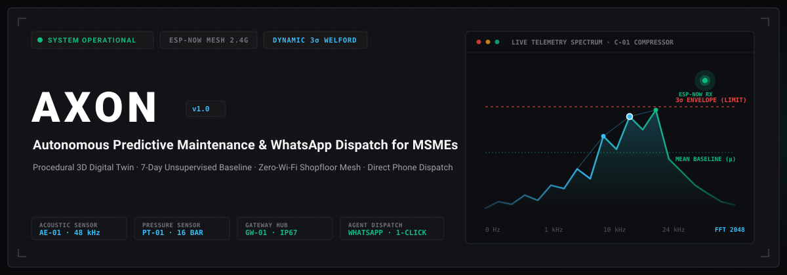

<p align="center">
  
</p>

<p align="center">
  <a href="https://axon-rho.vercel.app/" target="_blank" rel="noopener noreferrer">
    
  </a>
</p>

<p align="center">
  <a href="https://axon-rho.vercel.app/" target="_blank"></a>
  
  
  
  
  
  
</p>

---

## Executive Overview

Micro, Small, and Medium Enterprises (MSMEs) operate over 60% of critical manufacturing machinery—reciprocating air compressors, injection moulders, slurry pumps, and CNC spindles—yet **over 92% have zero predictive maintenance infrastructure**. Enterprise SCADA setups and industrial vibration platforms require tens of thousands of dollars in proprietary sensors, PLC integrations, cloud subscriptions, and dedicated vibration analysts.

**AXON** fundamentally shifts this paradigm:
- **Low-Cost Edge Sensing:** Retrofit acoustic emission (`AE-01`) and piezoresistive pressure (`PT-01`) pucks on existing equipment.
- **7-Day Dynamic Self-Calibration:** Unsupervised statistical baselining that learns individual machine acoustics without pre-labelled datasets or manual threshold setting.
- **Offline Factory Mesh:** 2.4 GHz ESP-NOW protocol guarantees telemetry delivery across noisy shopfloors with **zero machine-level Wi-Fi dependency**.
- **Autonomous WhatsApp Dispatch:** An agentic state machine detects anomalies, correlates planned shift idle windows, identifies certified local mechanics, and delivers 1-tap interactive approval notifications directly to the factory owner's smartphone.
- **Tier 1 Zero-Hardware DSP:** Instant browser-based microphone acoustic analysis for immediate zero-budget retrofits.

---

## 4 Core Architectural Pillars

<table>
  <tr>
    <td width="50%" valign="top">
      <h3>1. Procedural 3D Digital Twin</h3>
      <p>High-fidelity industrial air compressor twin built with <code>@react-three/fiber</code> and <code>@react-three/drei</code> primitives:</p>
      <ul>
        <li><b>Hardware Geometry:</b> Procedural cast-iron crankcase, cylinder head with cooling fins, ASME pressure safety valve, oil inspection port, and ribbed belt guard.</li>
        <li><b>Procedural Wiring:</b> Flexible 3D Bezier cable harnesses with nylon strain-relief glands connecting sensors back to terminal junction boxes.</li>
        <li><b>Floating HUD Callouts:</b> Dark-themed 3D labels with pointer tracking lines framing active telemetry.</li>
      </ul>
    </td>
    <td width="50%" valign="top">
      <h3>2. 7-Day Unsupervised Baseline</h3>
      <p>Replaces brittle hardcoded thresholds with dynamic statistical calibration using Welford's online algorithm:</p>
      <ul>
        <li><b>Online Moments:</b> Continuously updates running count, mean (&mu;), and squared deviations (<i>M</i><sub>2</sub>) across 100 duty cycles.</li>
        <li><b>Dynamic Envelope:</b> Derives exact sample variance (&sigma;<sup>2</sup>) and standard deviation (&sigma;) to establish an empirical 3&sigma; normal envelope.</li>
        <li><b>Zero Overfitting:</b> Accommodates normal machine wear and load changes without triggering false alarms.</li>
      </ul>
    </td>
  </tr>
  <tr>
    <td width="50%" valign="top">
      <h3>3. Offline ESP-NOW Factory Mesh</h3>
      <p>Industrial shopfloors frequently suffer from dead zones, steel interference, and IT firewall restrictions:</p>
      <ul>
        <li><b>Zero Wi-Fi at Machines:</b> Edge nodes broadcast compact binary structs over connectionless 2.4 GHz ESP-NOW peer-to-peer RF.</li>
        <li><b>Central Gateway Hub (GW-01):</b> Rugged wall-mounted IP67 enclosure that aggregates node packets and buffers telemetry.</li>
        <li><b>Reactive Micro-Interactions:</b> Real-time animated 3D particle pings travel from machine sensors to the gateway upon telemetry events.</li>
      </ul>
    </td>
    <td width="50%" valign="top">
      <h3>4. Autonomous WhatsApp Agent</h3>
      <p>Autonomous state machine handling incident triage and logistics without manual intervention:</p>
      <ul>
        <li><b>Anomaly Detection:</b> Gateway flags dynamic baseline breaches (&Delta; &gt; 3&sigma;).</li>
        <li><b>Shift Idle-Window Matching:</b> Identifies upcoming non-operational windows (e.g., between shifts) to avoid unscheduled downtime.</li>
        <li><b>Logistics Broker:</b> Matches certified local mechanics and replacement valve/gasket inventory.</li>
        <li><b>Interactive Mobile Action:</b> Dispatches WhatsApp payload with 1-click <i>Approve Dispatch</i> or <i>Dismiss / Recalibrate</i> actions.</li>
      </ul>
    </td>
  </tr>
</table>

---

## System Architecture Pipeline

```mermaid
graph LR
    classDef edgeNode fill:#111317,stroke:#38bdf8,stroke-width:1.5px,color:#f4f4f5;
    classDef mesh fill:#18181b,stroke:#23262d,stroke-width:1.5px,stroke-dasharray: 4 4,color:#a1a1aa;
    classDef gateway fill:#111317,stroke:#10b981,stroke-width:1.5px,color:#f4f4f5;
    classDef swarm fill:#111317,stroke:#8b5cf6,stroke-width:1.5px,color:#f4f4f5;
    classDef whatsapp fill:#111317,stroke:#10b981,stroke-width:2px,color:#ffffff;

    subgraph Shopfloor ["Factory Floor - Zero Wi-Fi Required"]
        COMP["MSME Air Compressor Rig"]:::edgeNode
        AE["AE-01 Acoustic Puck Sensor"]:::edgeNode
        PT["PT-01 Pressure Transducer"]:::edgeNode
        EDGE["ESP32 Edge Node - Welford 3-Sigma"]:::edgeNode
        MESH(["ESP-NOW Mesh - 2.4 GHz RF"]):::mesh
        GW["GW-01 Gateway Hub - IP67 Wall Mount"]:::gateway
    end

    subgraph Cloud ["AXON Cloud Swarm"]
        DISPATCH["Agentic Dispatch State Machine"]:::swarm
        SCHED["Shift Idle Window Matcher"]:::swarm
        LOGIST["Certified Technician Registry"]:::swarm
    end

    subgraph Mobile ["Factory Management"]
        PHONE["WhatsApp Mobile Interface - 1-Click Action"]:::whatsapp
    end

    COMP --> AE
    COMP --> PT
    AE --> EDGE
    PT --> EDGE
    EDGE -->|Compact Telemetry Packet| MESH
    MESH -->|Offline Packet RX| GW
    GW -->|Wi-Fi or LTE Webhook Alert| DISPATCH
    DISPATCH --> SCHED
    SCHED --> LOGIST
    LOGIST -->|Actionable Alert Card| PHONE
    PHONE -.->|Approve or Dismiss| DISPATCH
```



---

## Operational Modes

AXON features three seamlessly integrated operating tiers accessible via the top-level view toggle:

| Mode | Target User | Hardware Required | Description |
| :--- | :--- | :--- | :--- |
| **`AXON SIM`** <br/>*(Default View)* | Evaluators, Judges & Factory Managers | None (Web Twin) | High-fidelity 3D digital twin of MSME Compressor Rig C-01 with wall-mounted IP67 Gateway Hub, animated mesh pings, 7-day fast-forward calibration drawer, and interactive WhatsApp phone mock. |
| **`AXON LIVE MIC`** | MSMEs with Zero Hardware Budget | Laptop or Smartphone Mic | Tier 1 real-time acoustic DSP mode. Streams microphone input through Web Audio `AnalyserNode` (2048 FFT bins) to establish a dynamic baseline and detect mechanical anomalies live in-browser. |
| **`SCADA`** | Reliability Engineers & Analysts | Legacy Industrial Bench | Full enterprise SCADA interface with ISO vibration zone radial gauge (Zones A–D), FFT spectrum analyzer, time-to-threshold extrapolation, and client-side Isolation Forest anomaly detector. |

👉 **Try all three modes in your browser:** [https://axon-rho.vercel.app/](https://axon-rho.vercel.app/)

---

## 60-Second Evaluator Walkthrough

1. **Launch the Simulation:**  
   Open [https://axon-rho.vercel.app/](https://axon-rho.vercel.app/). The app automatically loads the default **`AXON SIM`** view with the 3D Compressor Rig and WhatsApp Mock Phone interface.
2. **Run Unsupervised Calibration:**  
   In the WhatsApp phone drawer on the right, click **`Start 7-Day Calibration`**. Watch the progress bar simulate 7 days of duty cycles in 10 seconds, calculating the running mean ($\mu$) and locking in the dynamic $3\sigma$ normal envelope.
3. **Trigger Fault Anomaly:**  
   Click **`Simulate Anomaly`** (or switch to SCADA to advance fault sliders). Observe the animated mesh particle ping traveling from the compressor sensors across the factory floor to the wall-mounted Gateway Hub.
4. **Experience Autonomous Dispatch:**  
   Watch the WhatsApp chat automatically execute:
   - **Triage:** Flags acoustic & pressure variance exceeding the $3\sigma$ threshold.
   - **Scheduling:** Matches a 2-hour idle window between production shifts.
   - **Logistics:** Assigns a certified local technician and prepares required replacement gaskets.
   - **One-Tap Action:** Tap **`Approve Dispatch`** to confirm or **`Dismiss`** to recalibrate.
5. **Explore Live Mic & SCADA Modes:**  
   Use the header toggle `[SCADA] ⇄ [AXON SIM] ⇄ [AXON LIVE MIC]` to inspect client-side DSP frequency extraction or full telemetry histories.

---

## Deployable Physical Firmware

The repository includes complete, production-ready Arduino C++ firmware and electrical schematics ready to flash to ESP32 hardware:

- **`firmware/edge_node/edge_node.ino`**:
  - ADC1 sampling of high-frequency acoustic emission, piezoresistive pressure, vibration RMS, and temperature proxies.
  - On-chip Welford online baseline mean and variance calculation ($3\sigma$ thresholding).
  - ESP-NOW connectionless broadcast (packet payload: 28 bytes).
- **`firmware/gateway_hub/gateway_hub.ino`**:
  - High-throughput ESP-NOW packet receiver callback.
  - Reactive hardware LED drivers (Power, Mesh RX pulse, Wi-Fi status, Anomaly alarm).
  - HTTP POST JSON webhook dispatcher formatted for the WhatsApp Cloud Agent.
- **`firmware/WIRING.md`**:
  - Complete GPIO pinout table, 1:2 passive voltage divider schematic (10 k&Omega; / 20 k&Omega;) protecting ESP32 ADCs from 5V industrial transducers, and power decoupling guidelines.

---

## Quick Start & Verification

```bash
# 1. Clone repository
git clone https://github.com/Awwad-007/AXON.git
cd AXON

# 2. Install dependencies
npm install

# 3. Start local development server (http://localhost:5173)
npm run dev

# 4. Run TypeScript typecheck
npm run typecheck

# 5. Run automated test suite (98 tests across 11 suites)
npm test

# 6. Build production bundle into dist/
npm run build
```

---

<details>
<summary><b>📁 Repository Architecture & Directory Tree (Click to expand)</b></summary>

```text
AXON/
├── docs/
│   └── axon-banner.svg               # Custom dark-mode SVG hero banner
├── firmware/
│   ├── edge_node/
│   │   └── edge_node.ino             # ESP32 compressor edge node firmware (ESP-NOW)
│   ├── gateway_hub/
│   │   └── gateway_hub.ino           # ESP32 central gateway firmware (HTTP Webhook)
│   └── WIRING.md                     # Hardware pinout table & divider schematic
├── src/
│   ├── components/
│   │   ├── hardware/
│   │   │   ├── AcousticSensor.tsx    # Procedural 3D IP65 acoustic emission puck (AE-01)
│   │   │   ├── PressureSensor.tsx    # Procedural 3D piezoresistive transducer (PT-01)
│   │   │   └── EdgeNode.tsx          # Procedural 3D IP65 acquisition node
│   │   ├── machines/
│   │   │   └── CompressorRig.tsx     # High-fidelity procedural 3D MSME compressor
│   │   ├── GatewayNode.tsx           # Wall-mounted IP67 gateway node & mesh pings
│   │   ├── MockPhoneUI.tsx           # WhatsApp smartphone agent dispatch interface
│   │   ├── Tier1MicMode.tsx          # Live browser acoustic DSP FFT visualizer
│   │   ├── HeaderBar.tsx             # 3-way view toggle & camera presets
│   │   ├── Dashboard.tsx             # SCADA metrics grid, ISO gauge & terminal
│   │   └── Scene.tsx                 # Three.js / React Three Fiber world viewport
│   ├── sim/
│   │   ├── agentFlow.ts              # Autonomous agent dispatch state machine
│   │   ├── audioDSP.ts               # Web Audio API 2048-bin FFT feature extractor
│   │   ├── useCalibration.ts         # 7-day unsupervised dynamic Welford calibration
│   │   ├── useLiveCalibration.ts     # Live microphone DSP calibration hook
│   │   ├── engine.ts                 # Physics simulation & telemetry math
│   │   └── assets.ts                 # Machine asset profiles & nominals
│   ├── App.tsx                       # Main application entry with default AXON SIM
│   └── main.tsx                      # DOM root mount with Inter font bundle
├── tests/                            # 11 automated test suites (98 unit & UI tests)
├── vercel.json                       # Vercel SPA rewrite configuration
├── vite.config.ts                    # Vite build configuration
└── package.json                      # Scripts & dependencies
```

</details>

---

<p align="center">
  <a href="https://axon-rho.vercel.app/" target="_blank" rel="noopener noreferrer">
    
  </a>
</p>

<p align="center">
  <span style="color: #71717a; font-size: 12px; font-family: monospace;">
    AXON · MSME PREDICTIVE MAINTENANCE &amp; AUTONOMOUS DISPATCH · BUILT FOR PRODUCTION
  </span>
</p>
